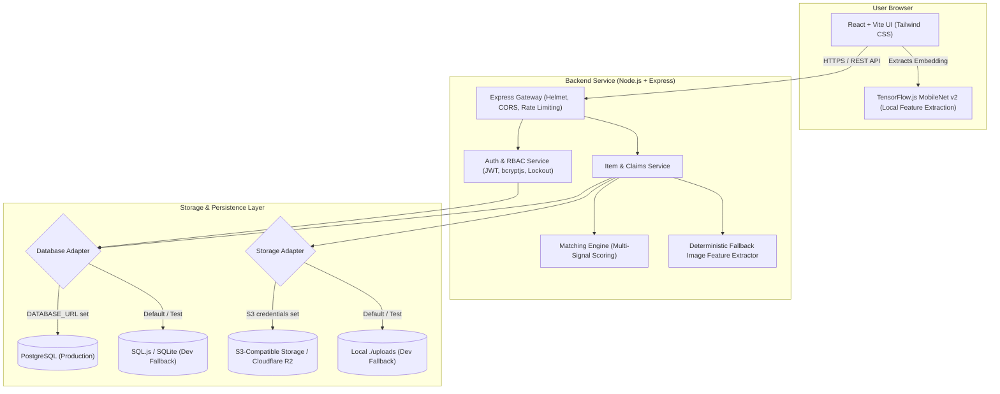

# CampusFind — Photo-Matched Lost & Found

[](https://www.typescriptlang.org/)
[](https://react.dev/)
[](https://vitejs.dev/)
[](https://nodejs.org/)
[](https://www.postgresql.org/)
[](https://tailwindcss.com/)

CampusFind is a full-stack campus lost-and-found management platform engineered for university students, faculty, campus security, moderators, and administrators. It replaces disorganized chat channels and physical bulletin boards with a structured, privacy-preserving reporting workflow and a deterministic multi-signal matching engine.

---

## Table of Contents

1. [Problem Statement](#problem-statement)
2. [Solution](#solution)
3. [Key Features](#key-features)
4. [How CampusFind Works](#how-campusfind-works)
5. [Matching Engine](#matching-engine)
6. [Authentication and Authorization](#authentication-and-authorization)
7. [Privacy and Security](#privacy-and-security)
8. [Technology Stack](#technology-stack)
9. [System Architecture](#system-architecture)
10. [Project Structure](#project-structure)
11. [Database Architecture](#database-architecture)
12. [Image and Media Storage Architecture](#image-and-media-storage-architecture)
13. [API Overview](#api-overview)
14. [Environment Variables](#environment-variables)
15. [Local Development Setup](#local-development-setup)
16. [Production Deployment](#production-deployment)
17. [Testing](#testing)
18. [Security Considerations](#security-considerations)
19. [Limitations](#limitations)
20. [Future Improvements](#future-improvements)
21. [Contributing](#contributing)
22. [License](#license)
23. [Disclaimer and Security Notice](#disclaimer-and-security-notice)

---

## Problem Statement

Traditional university lost-and-found operations suffer from critical communication bottlenecks:
- **Scattered Communication**: Reports are fragmented across WhatsApp groups, Reddit threads, campus forums, and informal social media pages.
- **Manual Discovery**: Finding matching items requires continuous manual monitoring of disparate channels.
- **Privacy Exposure**: Students frequently post personal phone numbers, student IDs, and private details in public forums.
- **Fraud and False Claims**: High-value electronics and personal property are susceptible to unauthorized claims without an audit trail.

---

## Solution

CampusFind provides a centralized, authenticated web portal where community members report lost or found property. The platform:
- Evaluates candidate pairs across multiple signals (visual features, text description, category taxonomy, physical location, and temporal proximity).
- Protects personal data by withholding item owner contact information until a claimant provides verifiable proof that is reviewed and approved by an authorized campus moderator.
- Supports dual-mode persistence (PostgreSQL for production; embedded SQLite for local development and testing) and pluggable cloud object storage (S3/Cloudflare R2 with local disk fallback).

---

## Key Features

- **Item Reporting**: Standardized forms for reporting lost and found items, including categories, campus locations, GPS coordinates, event timestamps, descriptions, and photo attachments.
- **Multi-Signal Matching**: Automated scoring that pairs complementary `LOST` and `FOUND` listings and computes confidence tiers (`VERY_LIKELY`, `LIKELY`, `POSSIBLE`, `LOW`).
- **Human-Readable Explanations**: Generated breakdowns explaining why two items were matched (e.g., category match, location proximity, visual similarity).
- **Client-Side Visual Feature Extraction**: MobileNet running directly in the browser to compute image feature vectors before upload, reducing backend compute overhead.
- **Server-Side Fallback Feature Extraction**: Deterministic lightweight server-side feature extractor that computes a normalized feature vector when client-side extraction is unavailable.
- **Role-Based Access Control (RBAC)**: Distinct permissions for `STUDENT`, `STAFF`, `MODERATOR`, and `ADMIN` roles.
- **Privacy-Preserving Claims Flow**: Item owner contact details are strictly redacted from public endpoints. Claimants must submit verification answers to prove ownership.
- **Moderator Dashboard**: Dedicated interface for campus staff to inspect match candidates, audit claims, approve returns, and manage resolved inventory.
- **Audit Logging**: Immutable tracking of moderator status changes and claim reviews for accountability.
- **Security-First Architecture**: Account lockout after consecutive failed logins, token rotation for refresh tokens, strict CORS allowlisting, and HTTP header hardening via Helmet.

---

## How CampusFind Works

```
[ User Reports Item ] 
       │
       ▼
[ Client-Side MobileNet ] ──► Extracts 64-dim visual embedding in browser
       │
       ▼
[ Authenticated API ] ─────► Validates input, sanitizes text, verifies file signature
       │
       ▼
[ Storage Adapter ] ───────► Stores image (Cloudflare R2 / AWS S3, or local disk fallback)
       │
       ▼
[ Database Adapter ] ──────► Persists item record (PostgreSQL or local SQLite fallback)
       │
       ▼
[ Matching Engine ] ───────► Queries candidate items of opposite type
                             Computes composite similarity score
                             Persists match pairs with human-readable rationale
```

1. **Submission**: A user submits a lost or found report with item attributes, location, date/time, and an optional image.
2. **Feature Extraction**: If an image is provided, TensorFlow.js MobileNet computes a normalized visual embedding in the browser. If unavailable, the server generates a lightweight deterministic fallback representation directly from the image buffer.
3. **Storage & Persistence**: The photo is uploaded to object storage, and the item metadata is written to the database.
4. **Automated Matching**: The system executes candidate filtering and computes a composite similarity score against complementary items.
5. **Claim & Verification**: A student who identifies their item files a claim with proof of ownership. FOUND reports can record a private finder-only verification detail plus a public hint describing its type.
6. **Moderator Review**: A moderator or administrator compares the claimant's answer with the hidden finder detail. The hidden detail is never mapped into public `Item` responses.
7. **Handover**: After approval, only the claimant receives the six-digit handover code. The claimant confirms receipt without entering a code; the finder enters the claimant's code. The item becomes `RESOLVED` only after both confirmations.

---

## Matching Engine

The matching engine uses a deterministic multi-signal scoring algorithm to compute similarity between a `LOST` item and a `FOUND` item.

### Similarity Signals

| Signal | Description | Methodology |
|---|---|---|
| **Image** | Visual feature correlation | Cosine similarity between normalized 64-dimensional feature vectors |
| **Text** | Title and description correlation | Combined token Jaccard similarity and character-level Levenshtein similarity |
| **Category** | Item classification match | Exact taxonomic match, hierarchical proximity, or category penalty |
| **Location** | Spatial proximity | Great-circle distance calculated via the Haversine formula over GPS coordinates and campus zone matching |
| **Time** | Temporal proximity | Half-life decay function based on the elapsed time between lost and found events |

### Dynamic Weight Renormalization

When an item is submitted without an image, the matching engine dynamically renormalizes the remaining signal weights (text, category, location, time) so the composite score remains calibrated on a `0.0` to `1.0` scale without penalizing photo-less items:

$$\text{Composite Score} = \sum_{i} \left( w_i \times s_i \right)$$

### Visual Feature Extraction

- **Primary (Client-Side)**: Uses TensorFlow.js (`@tensorflow/tfjs` and `@tensorflow-models/mobilenet`, MobileNet v2, alpha 0.5) to generate feature vectors locally in the browser.
- **Fallback (Server-Side)**: When client-side extraction is bypassed or unavailable, a server-side routine computes a deterministic lightweight 64-dimensional color and byte distribution vector directly from the uploaded buffer. This is a lightweight heuristic representation, not a deep-learning model.

---

## Authentication and Authorization

- **Stateless Access Tokens**: Short-lived JSON Web Tokens (JWT) sent via `Authorization: Bearer <token>`.
- **Hashed Refresh Tokens**: Cryptographically secure, high-entropy refresh tokens. Only SHA-256 hashes of refresh tokens are stored in the database.
- **Token Rotation & Revocation**: Refresh tokens are rotated upon use; previous tokens are immediately revoked to mitigate replay attacks.
- **Role-Based Access Control (RBAC)**:
  - `STUDENT`: Create items, submit claims on others' items, manage personal listings, view received notifications.
  - `STAFF` / `MODERATOR`: Access moderation dashboards, review and resolve claims, transition item states, inspect audit trails.
  - `ADMIN`: Full administrative control, system audit inspection, role assignment.
- **Account Lockout**: After 5 consecutive failed login attempts, accounts are locked for 15 minutes to defend against brute-force attacks. Lockout counters and timestamps are persisted to survive process restarts.
- **Credential Sanitization**: Password hashes, failed attempt counters, and lockout timestamps are filtered out of all API responses.

---

## Privacy and Security

- **Strict Exact-Match CORS**: In production, the backend allows only explicitly configured origins defined in `CORS_ORIGIN`. Wildcard origins (`*`) are prohibited when credentials are enabled.
- **HTTP Header Hardening**: Secured with Helmet to apply Content Security Policy (CSP), prevent MIME-type sniffing (`X-Content-Type-Options: nosniff`), and mitigate clickjacking (`X-Frame-Options`).
- **Rate Limiting**: Configured with `express-rate-limit` to restrict request volume on general API routes and enforce tighter thresholds on authentication endpoints.
- **Image Validation**:
  - File buffers are checked against magic-byte signatures (`image/jpeg`, `image/png`, `image/webp`). Disguised executables or scripts are rejected regardless of file extension.
  - File sizes are strictly capped (default 5MB).
  - Filenames are randomized with UUIDs to prevent file overwrites.
  - Directory traversal sequences (`../`, `/`) are blocked using path validation utilities.
- **Contact Information Protection**: Item owner contact details are hidden from public API responses and are exposed only to authorized claimants after moderator approval.
- **Self-Claim Prevention**: Users are prohibited from submitting claims on their own listings or approving their own claims.

---

## Technology Stack

### Frontend
- **Framework**: React 18
- **Language**: TypeScript
- **Tooling**: Vite
- **Styling**: Tailwind CSS
- **Icons**: Lucide React
- **Animation**: Motion
- **In-Browser Vision**: TensorFlow.js (`@tensorflow/tfjs`, `@tensorflow-models/mobilenet`)

### Backend
- **Runtime**: Node.js (18+)
- **Server**: Express
- **Language**: TypeScript (executed via `tsx` in development, compiled to CommonJS via `esbuild` for production)
- **Authentication**: `jsonwebtoken`, `bcryptjs`
- **Security**: `helmet`, `cors`, `express-rate-limit`
- **File Ingestion**: `multer`
- **Production Database**: PostgreSQL (`pg`)
- **Development Database**: SQL.js / SQLite (`sql.js`)
- **Object Storage**: AWS SDK for JavaScript v3 (`@aws-sdk/client-s3`)

---

## System Architecture



---

## Project Structure

```
.
├── backend/
│   ├── auth/                 # Authentication middleware, JWT handling, login security
│   ├── matching/             # Multi-signal matching modules
│   │   ├── candidate_filter.ts
│   │   ├── category_similarity.ts
│   │   ├── explanation.ts
│   │   ├── image_similarity.ts
│   │   ├── location_similarity.ts
│   │   ├── scoring.ts
│   │   ├── text_similarity.ts
│   │   └── time_similarity.ts
│   ├── models/               # Shared TypeScript data models and interfaces
│   ├── routes/               # Express route handlers
│   │   ├── adminRoutes.ts
│   │   ├── authRoutes.ts
│   │   ├── claimRoutes.ts
│   │   ├── itemRoutes.ts
│   │   └── notificationRoutes.ts
│   ├── services/             # Core business logic services
│   │   ├── auditService.ts
│   │   ├── claimService.ts
│   │   ├── itemService.ts
│   │   ├── matchingService.ts
│   │   ├── notificationService.ts
│   │   └── storageService.ts # Dual-mode S3/R2 and local disk storage adapter
│   ├── tests/                # Automated test runner and comprehensive test suite
│   ├── utils/                # Sanitization, validation, image security, feature extractors
│   ├── config.ts             # Centralized environment configuration
│   └── database.ts           # Dual-mode database adapter (PostgreSQL + SQL.js)
├── src/                      # Frontend React application
│   ├── components/           # Reusable UI components (Navbar, ProtectedRoute, etc.)
│   ├── pages/                # Application views (Dashboard, ItemDetails, Login, Admin, etc.)
│   ├── services/             # Frontend API client and MobileNet feature extractor
│   ├── types.ts              # Frontend domain models and types
│   ├── App.tsx               # Primary layout and route definitions
│   └── main.tsx              # React application entry point
├── public/                   # Static assets
├── server.ts                 # Full-stack server entry point (Express + Vite middleware)
├── package.json              # Dependency manifests and scripts
├── tsconfig.json             # TypeScript compiler configuration
└── vite.config.ts            # Vite bundler configuration
```

---

## Database Architecture

CampusFind implements a dual-mode persistence layer in `backend/database.ts`:
- **PostgreSQL Mode**: Activated whenever a valid PostgreSQL connection string is provided in `DATABASE_URL`. Operates with a managed connection pool (`pg.Pool`). Placeholders (`?`) are translated to indexed parameters (`$1, $2, ...`) dynamically.
- **SQL.js / SQLite Mode**: Fallback mode for local development and test environments when `DATABASE_URL` is omitted. Runs SQLite compiled to WebAssembly with zero external dependencies.
- **Duplicate approval recovery**: On startup, before creating `idx_claims_one_approved_per_item`, the initializer keeps one APPROVED claim per item (fully confirmed first, then earliest non-null `reviewed_at`, then lowest `id`). Extra approvals are reset to PENDING, their handover fields are cleared, and each reset writes `CLAIM_DUPLICATE_APPROVAL_RESET` to `audit_logs`. This migration is idempotent and sends no notifications.
- **Verification-detail audit privacy**: Detail-change audit notes contain HMAC-SHA256 `old_hash` / `new_hash` values, keyed by `VERIFICATION_DETAIL_AUDIT_SECRET`. Production startup fails if that secret is missing or shorter than 32 characters.

### Primary Entities

| Table | Purpose |
|---|---|
| `users` | User accounts, hashed passwords, roles (`STUDENT`, `STAFF`, `MODERATOR`, `ADMIN`), failed login attempts, and lockout timestamps. |
| `refresh_tokens` | Secure token hashes, user foreign keys, expiration dates, and revocation flags. |
| `items` | Lost and found reports, title, description, category, location, coordinates, event time, image URLs, 64-dim embedding arrays, finder-only `verification_detail`, optional `verification_hint`, owner ID, and status (`OPEN`, `MATCHED`, `RESOLVED`). |
| `matches` | Matched item pairs, individual sub-scores (image, text, category, location, time), total score, and generated explanations. |
| `claims` | Claim records, claimant ID, item ID, verification answers, reviewer ID, approval/handover code, claimant/finder confirmation timestamps, and status (`PENDING`, `APPROVED`, `REJECTED`). |
| `notifications` | In-app alerts, read status flags, and action links. |
| `audit_logs` | Immutable audit log of administrative actions, status transitions, and claim resolutions. |

---

## Image and Media Storage Architecture

Media handling is abstracted through `backend/services/storageService.ts`:

- **Cloud Object Storage (Production)**: When `S3_BUCKET`, `S3_ACCESS_KEY_ID`, and `S3_SECRET_ACCESS_KEY` are provided, uploads stream directly to an S3-compatible service (such as Cloudflare R2 or AWS S3). Files are served using a configured public CDN prefix (`S3_PUBLIC_URL_PREFIX`).
- **Local Filesystem Fallback (Development)**: When S3 credentials are not configured, files are stored locally in the `./uploads` directory and served via a restricted static route in Express.
- **Security Protections**:
  - Image signatures verified using magic bytes (`image/jpeg`, `image/png`, `image/webp`).
  - Cryptographically random filenames prevent namespace collisions.
  - Path traversal verification ensures uploads cannot escape designated directories.
  - Cloud credentials are kept server-side and never exposed to the client.

---

## API Overview

The backend exposes a REST API under the `/api` prefix. Representative endpoint categories include:

| Category | Typical Endpoints | Description |
|---|---|---|
| **Health** | `GET /api/health` | Service health status and readiness probe |
| **Authentication** | `POST /api/auth/register`<br>`POST /api/auth/login`<br>`POST /api/auth/refresh`<br>`POST /api/auth/logout`<br>`GET /api/auth/me` | Account creation, JWT issuance, session management, and profile inspection |
| **Items** | `GET /api/items`<br>`POST /api/items`<br>`GET /api/items/:id`<br>`PATCH /api/items/:id/verification-detail`<br>`DELETE /api/items/:id` | Item catalog browsing, filtering, authenticated reporting with photo uploads, and owner/staff repair of legacy FOUND verification details |
| **Claims** | `POST /api/claims`<br>`GET /api/claims/my-claims`<br>`GET /api/claims/item/:id`<br>`POST /api/claims/:id/handover/confirm` | Ownership claim submission, user claim history, and two-party handover confirmation |
| **Moderation** | `GET /api/admin/dashboard`<br>`GET /api/admin/audit-logs`<br>`POST /api/admin/items/:id/status`<br>`POST /api/claims/:id/review` | Administrative dashboards, status transitions, claim reviews, and compliance logs |
| **Notifications** | `GET /api/notifications`<br>`POST /api/notifications/:id/read`<br>`POST /api/notifications/read-all` | User notification retrieval and status updates |

*Note: Verify exact parameter schemas and endpoint contracts directly against `backend/routes/*`.*

---

## Environment Variables

All configuration is managed via environment variables.

> **CRITICAL SECURITY NOTE:**
> Never commit `.env` files containing real secrets to version control. Set sensitive values exclusively through your hosting provider's secure environment variable settings. Variables prefixed with `VITE_` are bundled into client-side code and are visible to anyone inspecting network traffic; never put private secrets in `VITE_` variables.

### Configuration Reference

```bash
# Server Configuration
PORT=3000
NODE_ENV=production

# Frontend Origin for Strict CORS (Exact origin required in production; comma-separated for multiples)
CORS_ORIGIN=<YOUR_PUBLIC_FRONTEND_URL>

# JWT Authentication Secrets (Generate distinct, high-entropy random strings)
JWT_SECRET=<GENERATE_A_SECURE_SECRET>
JWT_REFRESH_SECRET=<GENERATE_A_DIFFERENT_SECURE_SECRET>
VERIFICATION_DETAIL_AUDIT_SECRET=<GENERATE_A_DISTINCT_SECURE_SECRET_AT_LEAST_32_CHARACTERS>
JWT_ACCESS_EXPIRES_IN=15m
JWT_REFRESH_EXPIRES_IN=7d

# Production Database (PostgreSQL)
# When provided, CampusFind activates PostgreSQL mode with connection pooling.
# When omitted, the server falls back to embedded SQL.js/SQLite for local development.
DATABASE_URL=<YOUR_DATABASE_URL>

# Persistent Object Storage (Cloudflare R2 / AWS S3)
# When provided, images stream directly to object storage.
# When omitted, images fall back to the local ./uploads directory.
S3_BUCKET=<YOUR_BUCKET>
S3_REGION=<YOUR_REGION>
S3_ENDPOINT=<YOUR_S3_ENDPOINT>
S3_ACCESS_KEY_ID=<YOUR_ACCESS_KEY_ID>
S3_SECRET_ACCESS_KEY=<YOUR_SECRET_ACCESS_KEY>
S3_PUBLIC_URL_PREFIX=<YOUR_PUBLIC_IMAGE_URL>

# Client-Side Public API URL (Used during frontend build)
# Only non-sensitive public URLs should use the VITE_ prefix.
VITE_API_URL=<YOUR_API_URL>
```

---

## Local Development Setup

### Prerequisites
- Node.js 18 or higher
- npm 9 or higher

### Steps

1. **Clone the Repository**
   ```bash
   git clone https://github.com/<YOUR_ORGANIZATION>/campusfind.git
   cd campusfind
   ```

2. **Install Dependencies**
   ```bash
   npm install
   ```

3. **Configure Environment Variables (Optional for Local Development)**
   Copy the example environment template:
   ```bash
   cp .env.example .env
   ```
   *Note: CampusFind runs out of the box in local development mode without PostgreSQL or S3 credentials using built-in SQLite and local `./uploads` storage.*

4. **Start Development Server**
   ```bash
   npm run dev
   ```
   The application will be available at `http://localhost:3000`.

---

## Production Deployment

CampusFind is designed for containerized deployment on platforms such as Render.

### Deployment Architecture
- **Web Service**: Node.js backend executing `npm run build` followed by `npm start`.
- **Database**: Managed PostgreSQL instance with `DATABASE_URL` linked to the web service.
- **Media Storage**: S3-compatible bucket (e.g., Cloudflare R2 or AWS S3) with credentials configured via environment variables.
- **Frontend**: Served directly through Express or deployed as a static site built with Vite.

### Deployment Workflow (Render Example)

1. **Provision PostgreSQL Database**:
   - Create a PostgreSQL database instance in the Render dashboard.
   - Copy the internal connection string (`postgres://...`).

2. **Deploy Web Service**:
   - Connect your GitHub repository to Render.
   - Select the `main` branch.
   - Set the runtime environment to **Node**.
   - Build Command: `npm install && npm run build`
   - Start Command: `npm start`

3. **Configure Environment Variables**:
   In the Render service environment settings, configure:
   - `NODE_ENV=production`
   - `DATABASE_URL=<YOUR_DATABASE_URL>`
   - `CORS_ORIGIN=<YOUR_PUBLIC_FRONTEND_URL>`
   - `JWT_SECRET=<GENERATE_A_SECURE_SECRET>`
   - `JWT_REFRESH_SECRET=<GENERATE_A_DIFFERENT_SECURE_SECRET>`
   - `S3_BUCKET=<YOUR_BUCKET>`
   - `S3_REGION=<YOUR_REGION>`
   - `S3_ENDPOINT=<YOUR_S3_ENDPOINT>`
   - `S3_ACCESS_KEY_ID=<YOUR_ACCESS_KEY_ID>`
   - `S3_SECRET_ACCESS_KEY=<YOUR_SECRET_ACCESS_KEY>`
   - `S3_PUBLIC_URL_PREFIX=<YOUR_PUBLIC_IMAGE_URL>`

---

## Continuous integration

GitHub Actions runs on every push and pull request. It installs the exact npm dependency graph using `npm ci`, then runs lint/type-checking, the unit/regression suite, the production build, and the PostgreSQL integration script against a disposable PostgreSQL 16 database named `campusfind_test`.

## Docker deployment

The multi-stage image uses Node.js 22, runs as the unprivileged `node` user, and includes only production dependencies in the runtime stage. The image does not copy `.env` files, uploads, databases, or build dependencies. Docker Compose runs the app with PostgreSQL 16 and health checks for both services.

Set these environment variables before starting Compose: `POSTGRES_PASSWORD` (URL-safe characters recommended), `JWT_SECRET`, `JWT_REFRESH_SECRET`, and `VERIFICATION_DETAIL_AUDIT_SECRET` (each secret at least 32 characters). Set `CORS_ORIGIN` to the trusted frontend origin when required. Then run:

```bash
docker compose build
docker compose up -d

docker compose ps
# The app health check must report healthy and this must return HTTP 200:
curl -i http://localhost:3000/health
```

## Runtime and reproducible installs

- Supported runtime: Node.js `>=22`.
- Package manager: npm `10.9.2` (`packageManager` is pinned in `package.json`).
- Install from the committed npm lockfile with `npm ci`; do not use `bun.lock` or mix package managers.
- Production startup requires a PostgreSQL `DATABASE_URL`; no SQLite fallback is permitted in `NODE_ENV=production`.

## Testing

The automated test suite evaluates the core business logic, matching formulas, security controls, and storage adapters.

### Running Tests

```bash
# Type check and lint codebase
npm run lint

# Execute automated test suite
npm test

# Verify production build compilation
npm run build
```

### PostgreSQL R1 Migration and Concurrency Checks

Run the PostgreSQL integration script only against a **disposable local test database**. It drops and recreates the entire `public` schema and truncates the test tables while checking startup recovery, duplicate-approval prevention, and concurrent handover completion. It refuses to run whenever `NODE_ENV=production`; for non-production runs it also requires `ALLOW_DESTRUCTIVE_POSTGRES_TESTS=YES`, a parsed database name with `test` as a whole segment delimited by `_` or `-` (for example, `campusfind_test`), and a host on the local allowlist (`localhost`, `127.0.0.1`, or `0.0.0.0`). The URL must use `postgres:` or `postgresql:`. Run `npm run build` before this command because the integration suite also starts the compiled production server to verify startup and graceful shutdown. Keep `ALLOW_DESTRUCTIVE_POSTGRES_TESTS` commented out in normal environments; enable it only for a disposable local `*_test` database. `DISABLE_HMR` is documented in `.env.example` for local development. It starts ten child Node processes simultaneously to test schema initialization on an empty database, an initialized database, and a database with duplicate APPROVED claims:

```bash
NODE_ENV=test \
ALLOW_DESTRUCTIVE_POSTGRES_TESTS=YES \
DATABASE_URL=postgresql://postgres:pw@localhost:5432/campusfind_test \
npm run test:postgres-r1
```

The script initializes an empty schema, tests ten simultaneous startup processes against empty, initialized, and duplicate-approval databases, seeds duplicate approvals after dropping the partial unique index, closes and reopens the pool to trigger startup recovery, then exercises simultaneous approval and handover calls with `Promise.all`. It also holds the schema advisory lock in a second session, verifies that startup fails with a lock-key-specific timeout, releases the lock, and confirms that startup succeeds. The production lock wait deadline is 60 seconds; the shorter deadline is enabled only inside the `NODE_ENV=test` probe. Do not point it at a development or production database.

### Current Test Count

The prior verified main-suite baseline was **133 passed, 0 failed**. This revision adds 13 new regression assertions for production database configuration, graceful shutdown, health status, and auth-log redaction, so **146 is the expected assertion total**. The changed revision's actual runtime count is **NOT VERIFIED** here because project dependencies could not be installed (npm registry DNS failed). The PostgreSQL integration script likewise had a prior verified 14/14 baseline; seven new assertions cover the tightened guard, lock timeout/recovery, and production-server startup/shutdown, so 21 checks are expected but NOT VERIFIED until run against a disposable PostgreSQL 16 database.

### Browser verification checklist (F13 — NOT VERIFIED in this environment)

No browser automation is committed for this flow. Complete this numbered checklist in a real browser before production; use a disposable test database and separate browser profiles for finder, claimant, and moderator roles.

1. Sign in as a finder and create a FOUND item with a distinctive private verification detail (for example, a phrase that is not in its title or public description) and a non-sensitive verification hint.
2. Open the public browse card and item-detail page as a signed-out visitor and as the claimant. Confirm the private detail is never displayed. In DevTools Network, inspect the non-moderator item JSON responses and confirm `verification_detail` is absent, not merely hidden with CSS.
3. Sign in as a different claimant, open the item, and submit a claim. Confirm the claim is visible in the moderator review queue and the finder cannot approve their own claim.
4. Sign in as a moderator and approve the claim. Confirm exactly one claim is APPROVED for the item and the handover code is visible to the claimant only; check the finder and a different signed-in account cannot retrieve it.
5. As the finder, enter the claimant's displayed handover code. Confirm the UI reports the first side's confirmation without marking the item RESOLVED yet.
6. As the claimant, confirm the handover. Refresh both views and confirm the item status is RESOLVED and the code is no longer exposed to unrelated users.
7. Keep DevTools Console open throughout the flow. Confirm there are no uncaught errors, no React errors, no failed critical asset requests, and no blocking `alert()` dialogs. Test once with an image attached to verify the lazy-loaded MobileNet embedding still runs (and once without an image to verify the no-image path).
8. Record the browser, Node version, database mode, exact commit/archive tested, and the results of each step above. Any failure blocks production readiness.

## Known Accepted Risks

- The baseline `npm audit` reported three moderate findings along the dependency chain `sprintf-js` → `argparse` → `@tensorflow/tfjs` (`@tensorflow/tfjs` is the direct dependency in this project).
- Do **not** run `npm audit fix --force`: the reported forced resolution downgrades TensorFlow.js to `2.1.0`, a breaking downgrade from the current `4.22.0`.
- Reachability of the `sprintf-js` denial-of-service advisory involving unbounded precision specifiers has **not been verified**. A source grep was run across `src`, `backend`, and `server.ts` for `sprintf-js`, `sprintf(`, and common printf-style format patterns; it returned no matches. That is evidence there is no direct application call site, but does not establish reachability inside the dependency itself or prove no indirect path can pass attacker-controlled strings. Keep the advisory accepted until the complete audit graph is reproducible and the package's runtime call path is reviewed.
- The three-moderate count is from the supplied baseline. On this revision, `npm audit` was attempted after adding the npm lockfile, but the registry audit endpoint could not be reached (`EAI_AGAIN registry.npmjs.org`); current advisory counts and reachability therefore remain NOT VERIFIED. Re-run `npm audit` on a network-enabled machine.

### Test Coverage Highlights
- **Image Similarity**: Unit vectors, orthogonal vectors, zero-vector bounds handling, missing vector normalization.
- **Text Similarity**: High similarity for matching terms, baseline rejection for divergent descriptions.
- **Spatial & Temporal Functions**: Haversine distance accuracy, coordinates boundary validation, half-life time decay.
- **Dynamic Weight Renormalization**: Score calibration with and without image vectors.
- **Security Controls**: Password complexity, account lockout progression, token rotation and revocation, image magic-byte inspection, path traversal protection, coordinate validation, HTML sanitization.
- **Role Enforcement & Privacy**: Self-claim prevention, self-approval prevention, claimant privacy scrubbing.
- **CORS & Preflight**: Origin validation, preflight response headers, credential omission on unauthorized origins.
- **Storage & Database Dual-Mode**: Parameter translation (`?` to `$n`), SQLite fallback, direct buffer embedding extraction, S3 client mocking.


---

## Security Considerations

- **Secret Isolation**: Never commit passwords, tokens, private keys, or cloud storage secrets to version control.
- **Credential Rotation**: In the event of an accidental credential disclosure, immediately invalidate and rotate the affected tokens and database passwords.
- **Origin Validation**: Production CORS strictly checks requesting origins. Do not use wildcard `*` origins alongside credentialed cookies or authorization headers.
- **Rate Limiting Scope**: By default, rate limits are held in memory. In horizontally scaled environments, configure a shared store such as Redis.
- **Data Retention**: Routinely purge revoked refresh tokens and resolved match pairs in accordance with university data governance policies.

---

## Limitations

- **Lightweight Vision Model**: TensorFlow.js MobileNet is a lightweight, general-purpose vision model intended for client-side efficiency, not a specialized lost-and-found forensic model.
- **Heuristic Scoring**: Match scores reflect probabilistic similarity and do not constitute definitive proof of legal ownership.
- **Human Verification Required**: The system is designed to assist, not replace, human moderators. High-value property handovers require staff confirmation.
- **Ephemeral Storage on Free Hosting**: Running without PostgreSQL or S3 on containerized hosts (such as Render free tiers) will result in data resets upon container recycling. Production deployments must use persistent PostgreSQL and cloud object storage. In `NODE_ENV=production`, startup requires `DATABASE_URL` to be a valid `postgres://` or `postgresql://` URL; SQLite fallback is disabled in production. PostgreSQL URLs using transaction-pooling poolers are not supported for schema-startup advisory locking.
- **Single-Process Rate Limiter**: The in-memory rate limiter protects individual instances. Multi-instance clusters require distributed tracking.

---

## Future Improvements

The following capabilities represent potential roadmap items and are not yet implemented:
- **Mobile Applications**: Dedicated Android and iOS client applications.
- **Push & Email Notifications**: Direct notifications via SMTP or web push services.
- **Dedicated Vision Embeddings**: Domain-tuned visual feature extractors optimized for common campus items.
- **Vector Search Engine**: Dedicated vector indexing for high-scale nearest-neighbor search.
- **Distributed Rate Limiting**: Redis-backed shared rate limiting for horizontally scaled clusters.
- **Single Sign-On (SSO)**: Integration with campus identity providers via SAML / OAuth / OIDC.
- **QR Code Recovery**: QR stickers to facilitate expedited return of registered personal items.
- **Multi-Campus Support**: Multi-tenant database partitioning for multi-campus university systems.
- **Automated Spam Detection**: Automated content filtering for fraudulent or abusive listings.

---

## Contributing

Contributions to CampusFind are welcome:

1. Fork the repository.
2. Create a feature branch (`git checkout -b feature/improvement`).
3. Commit your changes with clear, descriptive commit messages.
4. Verify that all lint checks and tests pass (`npm run lint && npm test`).
5. Open a Pull Request detailing the problem solved and the implementation approach.

---

## License

License: To be determined.

---

## Disclaimer and Security Notice

CampusFind is provided for educational and administrative campus operations. Similarity scores represent statistical correlations and should be verified prior to returning property.

**Maintainer Notice**: Ensure that no `.env` files, production database URLs, or cloud access keys are ever checked into source control. If any credential is inadvertently exposed, immediately revoke and rotate the secret through your cloud provider console.
